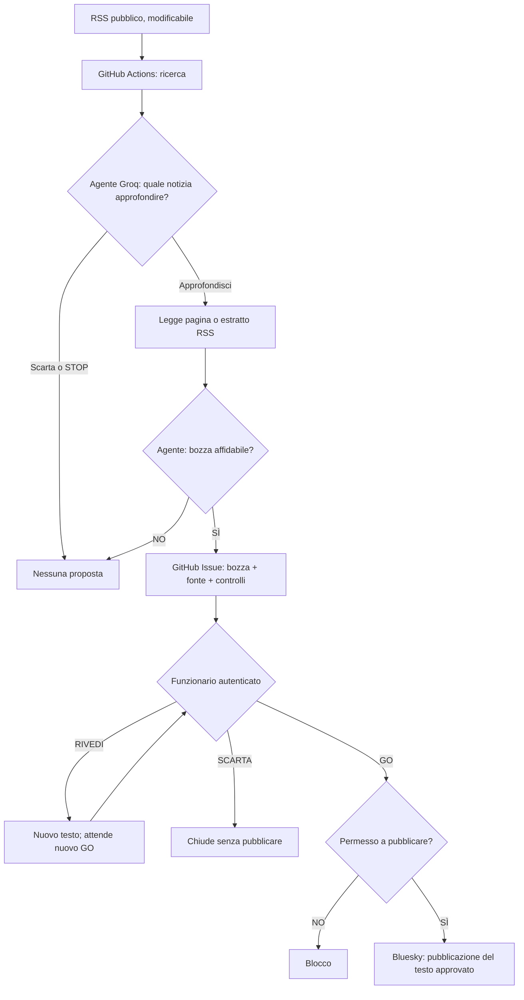

# Redazione PA — L'agente propone. Tu decidi.

**Prototipo didattico gratuito nel cloud** per il Modulo B sull'IA nella Pubblica Amministrazione italiana.

Un modello AI **sceglie una notizia RSS**, decide se approfondirla, consulta la pagina se accessibile, prepara una bozza prudente oppure scarta il contenuto. La proposta viene salvata in **GitHub Issues**. Solo dopo una **decisione umana GO** un workflow diverso può pubblicare il testo su un account **Bluesky di prova**.

> **Non è un servizio operativo di comunicazione istituzionale.** Usa solo fonti pubbliche, nessun dato personale o documento riservato e un account Bluesky sperimentale. La verifica della notizia e la responsabilità della pubblicazione restano alle persone.

## 1. Che cosa vedrai



**Perché è agentico?** Nel percorso LIVE è il modello — non un elenco fisso di istruzioni `if/else` — a decidere *quale candidato leggere*, se ne vale la pena e se preparare una proposta. Il codice fissa i limiti: al massimo **2 approfondimenti**, solo lettura di URL pubblici, nessuna pubblicazione diretta da parte del modello. È un **piccolo agente vincolato**, non un assistente autonomo illimitato.

### Servizi e costi

| Servizio | Ruolo | Piano iniziale |
|---|---|---|
| **GitHub Actions** | Esegue ricerca e pubblicazione nel cloud | Esecuzioni su runner standard gratuite per repository pubblici, secondo condizioni GitHub |
| **GroqCloud API** | Modello AI `openai/gpt-oss-20b` | Tier Free con limiti per minuto/giorno, senza obbligo di passare al tier a pagamento |
| **GitHub Issues** | Registro proposte, approvazioni e azioni | Incluso nel repository |
| **GitHub Pages** | Pannello di consultazione | Gratis per repository pubblico |
| **Bluesky** | Post su account dimostrativo | Non serve un servizio AI a pagamento |

I piani gratuiti e i limiti possono cambiare. **Questo progetto non attiva upgrade a pagamento.** Quando mancano quote o credenziali, il workflow fallisce senza pubblicare.

## 2. Preparazione: cosa devi avere

- Un account GitHub (puoi usare il tuo).
- Un **repository pubblico dedicato**: suggerimento **`Redazione-PA-Agentica`** sotto l'account **`gigicogo`**.
- Un account gratuito su [GroqCloud](https://console.groq.com/keys), con **API key** (per la modalità LIVE).
- Un account **Bluesky di prova** (non quello istituzionale). Crea una **App Password** nelle impostazioni del profilo Bluesky.

> **Non inserire mai chiavi Groq o password Bluesky in `index.html`, `README.md`, `config.json` o in un commit.** Le chiavi rimangono esclusivamente nei **GitHub Actions Secrets**.

## 3. Carica i file su GitHub — passo dopo passo

1. Scarica e **estrai lo ZIP** del progetto sul tuo computer.
2. Su GitHub scegli **New repository** e chiamalo `Redazione-PA-Agentica`; seleziona **Public**.
3. Il modo più affidabile per caricare *anche la cartella nascosta* `.github/workflows` è usare **GitHub Desktop** oppure **git**. La cartella `.github` è necessaria: contiene le due automazioni cloud.
4. Con git, dalla cartella estratta:

   ```bash
   git init
   git branch -M main
   git add .
   git commit -m "Prima versione Redazione PA"
   git remote add origin https://github.com/gigicogo/Redazione-PA-Agentica.git
   git push -u origin main
   ```

   Se GitHub richiede l'autenticazione, usa la procedura ufficiale di GitHub Desktop o Git Credential Manager, non inserire password nel codice.

5. **Controlla** nel repository che siano presenti **`index.html`**, **`config.json`**, **`scripts/`** e **`.github/workflows/ricerca.yml`** più **`approvazione.yml`**. Se mancano gli ultimi due, Actions non partirà.
6. Se scegli un nome diverso da `Redazione-PA-Agentica`, modifica **`repository`** in `config.json` con `utente/nome-repository`.

## 4. Abilita GitHub Pages

1. Repository → **Settings → Pages**.
2. **Build and deployment → Source: Deploy from a branch**.
3. **Branch: main** e cartella **/(root)** → **Save**.
4. Quando il deploy sarà verde, la pagina sarà (con il nome suggerito):

   **https://gigicogo.github.io/Redazione-PA-Agentica/**

Se GitHub Actions mostra una **X rossa** sul deploy Pages, apri il job fallito e leggi il messaggio: non significa automaticamente che il codice dell'agente sia errato.

## 5. Imposta i permessi dei workflow

Nel repository apri **Settings → Actions → General**. Verifica che Actions sia abilitato e che i workflow possano creare/modificare le Issues con `GITHUB_TOKEN`. I file YAML già dichiarano `issues: write`. Se una policy del repository o dell'organizzazione lo impedisce, abilita le autorizzazioni necessarie o chiedi all'amministratore.

Il workflow **approvazione** esegue comandi soltanto se provengono dal **proprietario autenticato** del repository. Questo è intenzionale: i visitatori della pagina pubblica non possono autorizzare una pubblicazione.

## 6. PRIMA PROVA — Demo senza token AI

Non configurare ancora le chiavi. Questa prova serve a verificare GitHub Actions e Issues.

1. Vai su **Actions → Redazione PA · ricerca e proposta**.
2. Premi **Run workflow**.
3. Lascia `mode = demo`, lascia vuoto `rss_url`, conferma **Run workflow**.
4. Il workflow usa `examples/rss-demo.xml` (notizie **inventate**), e una bozza **simulata**: **non chiama nessun modello AI**.
5. Se il run è **verde**, apri la sezione **Issues**: dovrebbe esserci una proposta etichettata `pa-bozza`.
6. Apri la pagina GitHub Pages: la proposta appare nel pannello. Il pulsante **RIVEDI** prepara il testo da incollare come commento in GitHub Issues.
7. Puoi provare `/scarta`, che chiude la proposta. Un GO in modalità DEMO viene **sempre bloccato**.

⚠️ Una proposta demo può apparire già elaborata dopo il primo run: il progetto non duplica articoli già usati. Per ricominciare con lo stesso contenuto, usa un nuovo repository di prova oppure modifica l'URL dell'articolo nel feed di esempio.

## 7. MODALITÀ LIVE — aggiungi solo Groq

1. Registrati su **[GroqCloud](https://console.groq.com/keys)** e crea una API key sul piano gratuito.
2. Repository GitHub → **Settings → Secrets and variables → Actions → Secrets → New repository secret**.
3. Nome: **`GROQ_API_KEY`**. Valore: la chiave generata da Groq. Salva.
4. Nel file `config.json`, modifica eventualmente `rss_url`. Di default viene proposto il feed AgID, ma il tuo Ente o l'aula possono scegliere un altro RSS pubblico.
5. In alternativa, nel **Run workflow** seleziona `mode = live` e scrivi un altro URL nel campo facoltativo `rss_url`: **questo sostituisce il feed predefinito per quella singola esecuzione**.
6. Esegui il workflow LIVE. Il modello prova a scegliere una notizia, recuperarla e proporre un post **oppure può decidere di non creare nulla**. Non è un errore se non pubblica nulla: è un comportamento di cautela previsto.
7. Leggi la nuova GitHub Issue: troverai **fonte, bozza, motivazione, controlli e traccia delle decisioni**. Controlla personalmente il contenuto sulla fonte primaria.

**Attenzione:** alcuni siti bloccano le richieste automatiche (per esempio un RSS può restituire 403). In quel caso scegli un altro feed pubblico. Se la pagina completa non è accessibile, il sistema registra il limite e prova a lavorare solo sull'estratto RSS, quando sufficiente.

## 8. Abilita Bluesky — sempre su account di prova

1. Accedi al tuo account sperimentale Bluesky.
2. Vai nelle impostazioni delle password applicazione (**App Passwords**) e creane una con nome `Redazione PA demo`. **Non usare la password principale dell'account.**
3. Su GitHub salva due nuovi **Actions Secrets**:

   | Secret | Contenuto |
   |---|---|
   | `BLUESKY_HANDLE` | per esempio `nomeprova.bsky.social` |
   | `BLUESKY_APP_PASSWORD` | la App Password creata su Bluesky |

4. Modifica `config.json`: imposta **`"publishing_enabled": true`**. Questa è una scelta esplicita, separata dalla semplice installazione.
5. Assicurati di usare una **Issue LIVE**. Apri il post, controlla la fonte, correggi se serve e commenta con il comando **`/go`** (da solo su una riga). Il workflow di approvazione parte in automatico.
6. Torna su **Actions → Redazione PA · approvazione umana**: quando il run è verde, la Issue riporta il link al post Bluesky e viene chiusa. È la **registrazione di tracciabilità**.

Se il post supera il limite Bluesky (testo + link), GO viene bloccato: usa RIVEDI per accorciarlo. Non vengono pubblicati post parziali.

## 9. Come funzionano i tre pulsanti

| Pulsante nel pannello | Cosa fa | Che cosa devi fare tu |
|---|---|---|
| **GO** | Copia `/go` e apre la Issue | Incolla `/go` nei commenti e premi **Comment**. Prima controlla il testo. |
| **RIVEDI** | Copia `/rivedi` + testo modificato e apre la Issue | Incolla nei commenti e premi **Comment**. Il sistema memorizza la revisione; per pubblicare serve un successivo `/go`. |
| **SCARTA** | Copia `/scarta` e apre la Issue | Incolla e invia: l'Issue viene chiusa, senza post. |

Perché serve il passaggio su GitHub? **GitHub Pages è un sito statico pubblico**. Se i pulsanti pubblicassero direttamente con una password nel JavaScript, chiunque potrebbe recuperarla. Le Issues e il workflow assicurano invece che l'approvazione provenga dall'account GitHub autenticato del proprietario.

### PAUSE e STOP globali

- **PAUSE pubblicazioni:** modifica `config.json`, imposta `"publishing_enabled": false` e salva un commit. Le nuove richieste `/go` verranno respinte. Le bozze restano disponibili.
- **PAUSE ricerche automatiche:** imposta `"scheduler_enabled": false` (è già così in partenza).
- **STOP di emergenza:** disabilita i workflow GitHub Actions e/o revoca la App Password su Bluesky. È la misura da usare anche se sospetti la compromissione di una credenziale.

Le modifiche a `config.json` hanno effetto sui successivi workflow, non annullano un invio già completato.

## 10. Ricerca giornaliera automatica (facoltativa)

Il workflow `ricerca.yml` comprende già una pianificazione nei giorni lavorativi. Per attivarla **dopo i test** modifica:

```json
"scheduler_enabled": true
```

Le esecuzioni sono approssimative: GitHub Actions può ritardarle. Il sistema confronta le fonti già elaborate e **non dovrebbe creare nuove Issue per gli stessi URL**. In un laboratorio è preferibile lasciare la pianificazione spenta e usare **Run workflow**.

## 11. Cosa documentiamo (tracciabilità)

Ogni Issue contiene:

- l'URL della fonte e l'RSS di partenza;
- la motivazione della selezione e il tentativo di approfondimento;
- la bozza e gli elementi da controllare;
- la traccia delle decisioni del modello (oppure l'indicazione DEMO);
- le revisioni dell'operatore, i comandi GO / RIVEDI / SCARTA e il relativo autore GitHub;
- in caso di GO riuscito, il link al post pubblicato.

**Il modello non certifica l'esattezza della notizia.** Le affermazioni devono essere riscontrate nella fonte originale. Le Issues restano pubbliche in un repository pubblico: mai dati personali, documenti riservati o segreti.

## 12. Problemi tipici

| Sintomo | Che cosa verificare |
|---|---|
| Pagina GitHub Pages **404** | `index.html` nella root, `Settings → Pages → main /(root)`, stato Actions |
| Pannello dice **impossibile leggere le Issues** | repository pubblico, nome `repository` in `config.json`, eventuale limite API GitHub per utenti anonimi |
| Workflow ricerca **rosso** | File `.github/workflows/ricerca.yml` presente, Actions abilitate, `issues:write` autorizzato |
| LIVE restituisce **HTTP 429** | Limite Groq Free raggiunto; riprova rispettando le quote, nessun addebito automatico previsto |
| RSS restituisce **403 / XML non valido** | Il sito blocca il recupero automatico oppure non fornisce davvero un feed RSS/Atom |
| Nessuna nuova Issue | L'agente ha scelto STOP/scarta, oppure l'articolo è già stato elaborato |
| GO commentato ma **non succede nulla** | Sei il proprietario del repository? C'è `approvazione.yml` nella branch main? Actions → log |
| GO respinto | `publishing_enabled=false`, modalità DEMO, fonte non HTTPS, post troppo lungo o credenziali mancanti |
| Bluesky **non pubblica** | handle corretto, App Password valida, rete/API disponibile, log workflow |

## 13. Verifica locale senza chiavi

Il software cloud non deve girare sul tuo computer, ma puoi controllare la lettura del feed demo prima di caricarlo:

```bash
python -m pip install -r requirements.txt
PREVIEW_ONLY=1 MODE=demo python scripts/research.py
python -m unittest discover -s tests -v
```

Questo genera solo una proposta **in console**. Non invia post, non apre Issues e non chiama un modello AI.

## 14. Possibili estensioni (NON incluse nella prima versione)

- Aggiungere una skill di verifica per consultare più fonti indipendenti.
- Aggiungere il flusso di revisione editoriale fra più funzionari con autorizzazioni distinte.
- Conservare versioni documentali secondo le procedure del proprio Ente.
- Creare una grafica social, mantenendo il controllo umano prima dell'invio.

### Fonti tecniche ufficiali

- [GitHub Actions — eventi e workflow](https://docs.github.com/en/actions/reference/workflows-and-actions/events-that-trigger-workflows)
- [GitHub — Secrets per Actions](https://docs.github.com/en/actions/how-tos/write-workflows/choose-what-workflows-do/use-secrets)
- [GitHub Pages — da branch](https://docs.github.com/en/pages/getting-started-with-github-pages/configuring-a-publishing-source-for-your-github-pages-site)
- [Groq — API OpenAI compatibile](https://console.groq.com/docs/openai)
- [Groq — limiti del piano Free](https://console.groq.com/docs/rate-limits)
- [Bluesky — autenticazione e pubblicazione](https://bsky.network/docs/bluesky-api/)

---

**Messaggio formativo:** abbiamo definito il perimetro dell'agente, gli abbiamo consentito di cercare e proporre, ma **abbiamo conservato alla persona l'ultima parola sulla pubblicazione**.
