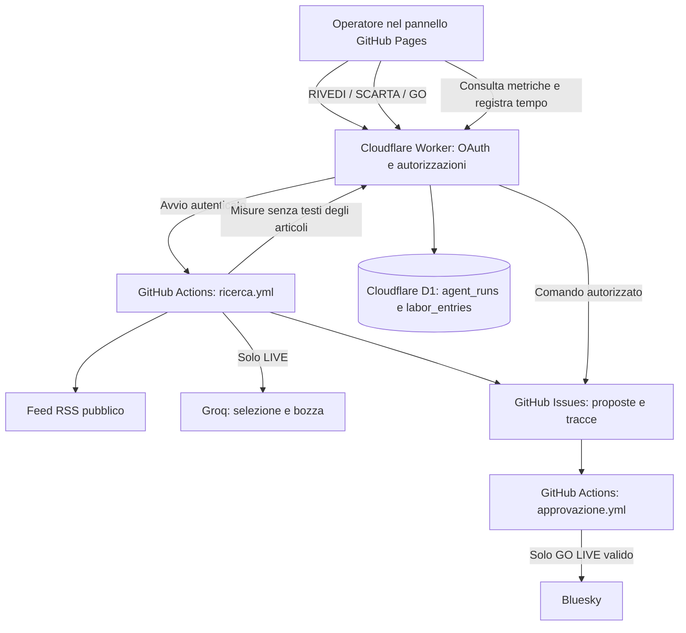

# Redazione PA — L'agente propone. Tu decidi.

**Laboratorio di intelligenza artificiale agentica, supervisione umana e controllo dei costi nella Pubblica Amministrazione.**

[**Apri la web app**](https://gigicogo.github.io/Redazione-PA-Agentica/)

> **La regola del progetto:** l'agente può cercare, selezionare, approfondire e scrivere una proposta. **Non può decidere autonomamente di pubblicarla.** L'operatore verifica la fonte, può correggere o scartare e autorizza esplicitamente ogni eventuale pubblicazione.

La **Redazione PA** è un prototipo didattico in cloud, sviluppato per mostrare in modo concreto il funzionamento e la governance di un agente IA. Dal pannello web è possibile avviare una ricerca su un RSS pubblico, valutare le proposte, pubblicare su Bluesky dopo un GO umano e consultare l'**Osservatorio dell'agente**: attività, token, stime di costo e lavoro umano.

**Non è un prodotto certificato né una piattaforma di comunicazione istituzionale pronta all'uso.** Non impiegare dati personali, documenti riservati o contenuti non destinati alla diffusione pubblica.

---

## Indice

1. [In cinque minuti: come si usa](#1-in-cinque-minuti-come-si-usa)
2. [LIVE e DEMO: la differenza](#2-live-e-demo-la-differenza)
3. [Le regole dell'agente: cambiare RSS non cambia missione](#3-le-regole-dellagente-cambiare-rss-non-cambia-missione)
4. [Il controllo umano: GO, RIVEDI e SCARTA](#4-il-controllo-umano-go-rivedi-e-scarta)
5. [Osservatorio: attività, consumi, costi e qualità](#5-osservatorio-attività-consumi-costi-e-qualità)
6. [Architettura: cosa lavora dietro le quinte](#6-architettura-cosa-lavora-dietro-le-quinte)
7. [Configurazione per l'amministratore](#7-configurazione-per-lamministratore)
8. [Sicurezza, responsabilità e limiti](#8-sicurezza-responsabilità-e-limiti)
9. [Problemi frequenti e verifiche](#9-problemi-frequenti-e-verifiche)
10. [Utilizzo didattico e sviluppi futuri](#10-utilizzo-didattico-e-sviluppi-futuri)

## 1. In cinque minuti: come si usa

Nelle normali operazioni **non occorre aprire GitHub**: GitHub Actions e GitHub Issues sono il motore tecnico e il registro delle attività, non l'interfaccia del funzionario.

1. Apri la [web app Redazione PA](https://gigicogo.github.io/Redazione-PA-Agentica/).
2. Premi **Accedi con GitHub** ed entra con l'utente autorizzato (nella configurazione di questo laboratorio: `gigicogo`).
3. Scegli **LIVE — Ricerca con IA** oppure **DEMO — Simulazione**.
4. In LIVE inserisci l'URL di un **feed RSS/Atom HTTPS pubblico** e premi **Avvia la ricerca**. Il feed scelto per la singola ricerca non riscrive `config.json`.
5. Attendi l'esito. L'agente può creare una proposta, scartare i candidati oppure non produrre nulla: **nessuna proposta non significa automaticamente errore**.
6. Se compare una proposta, apri la **fonte originale** e controlla fatti, date, attribuzioni e pertinenza; poi scegli **RIVEDI**, **SCARTA** o **GO**.
7. Apri **Osservatorio dell'agente** per consultare attività e consumi; puoi anche registrare i minuti dedicati al lavoro umano.

**Importante:** la ricerca e la pubblicazione sono due fasi separate. Avviare LIVE non pubblica automaticamente alcun contenuto.

## 2. LIVE e DEMO: la differenza

| | **LIVE — Ricerca con IA** | **DEMO — Simulazione** |
|---|---|---|
| Fonti | Legge il feed RSS pubblico indicato | Utilizza il feed di esempio `examples/rss-demo.xml`, con contenuti fittizi |
| Modello Groq | **Sì**: selezione e proposta affidate al modello | **No**: nessuna chiamata a Groq |
| Esito | Può creare una bozza oppure decidere STOP/SKIP | Esegue un percorso dimostrativo; può non creare una nuova Issue se il contenuto è già stato trattato |
| RIVEDI / SCARTA | Consentiti secondo le verifiche del sistema | Consentiti per esercitarsi |
| Pubblicazione con GO | Possibile **solo** se autorizzata e abilitata | **Sempre bloccata** |
| Osservatorio | Registra attività e token restituiti da Groq | Registra l'esecuzione con **zero token Groq** |

**DEMO dimostra il processo. LIVE mette alla prova il comportamento dell'agente.**

## 3. Le regole dell'agente: cambiare RSS non cambia missione

Il feed rappresenta **la materia prima**. La missione editoriale stabilisce **quali notizie cercare e con quali criteri scrivere**.

Nel pacchetto di riferimento, l'agente opera come **analista editoriale di una Pubblica Amministrazione**, rivolgendosi a *dipendenti pubblici e cittadini interessati alla trasformazione digitale*. Le linee editoriali chiedono tono informativo, chiarezza, prudenza, assenza di promozione e nessuna affermazione priva di riscontro nella fonte.

Questi criteri sono contenuti in `config.json` (`audience`, `editorial_guidelines`) e nei prompt di `scripts/research.py`. Se la configurazione pubblicata nel tuo repository è stata modificata, **prevalgono i valori effettivamente online**.

### Limiti operativi previsti dal codice

| Aspetto | Regola |
|---|---|
| Notizie candidate | Fino a **6** per ricerca, con i parametri di riferimento |
| Approfondimenti | Al massimo **2** tentativi |
| Valutazione | Il modello può scegliere **STOP** o **SKIP** e non creare alcuna proposta |
| Lettura | Si tenta il recupero della pagina; se inaccessibile, può essere usato soltanto l'estratto RSS, indicando il limite |
| Fonti | RSS pubblici HTTPS; sono previsti controlli sugli indirizzi per evitare accessi a risorse private/locali |
| Istruzioni esterne | Un articolo o un feed **non possono autorizzare azioni**: il modello non deve seguire istruzioni ricevute dalle fonti |
| Pubblicazione | Mai autonoma: dipende da una decisione umana e da controlli software |

I criteri editoriali affidati al modello **non sono un filtro matematico garantito**. L'IA può selezionare contenuti poco pertinenti o sbagliare la sintesi: la revisione resta necessaria.

### Posso usare un feed di sport o cinema?

**Sì**, se è pubblico, HTTPS e leggibile. Ma l'agente mantiene la missione PA/innovazione, salvo modifiche esplicite alle sue istruzioni.

| Notizia | Comportamento auspicabile con la missione attuale |
|---|---|
| Risultato di una partita | Tendenzialmente **STOP** |
| Prenotazione online di impianti sportivi comunali | **Possibile selezione** |
| Recensione di un film commerciale | Tendenzialmente **STOP** |
| Digitalizzazione di una cineteca pubblica | **Possibile selezione** |
| Nuovo servizio digitale comunale | **Candidato pertinente** |

Questi esempi **non garantiscono** che il modello risponda sempre così. Per creare una vera redazione dedicata a sport, cultura o turismo occorre modificare la missione (`audience`, `editorial_guidelines`) e, se necessario, i prompt Python, quindi effettuare nuovi test.

**RSS per una ricerca:** si cambia direttamente nel pannello. **RSS predefinito:** si modifica amministrativamente nel parametro `rss_url` di `config.json`. Sono due operazioni diverse.

## 4. Il controllo umano: GO, RIVEDI e SCARTA

Una proposta è una **bozza**, non un contenuto già autorizzato.

| Comando | Effetto |
|---|---|
| **RIVEDI** | Salva una nuova versione del testo e la registra nella cronologia. **Non pubblica.** Serve un successivo GO esplicito. |
| **SCARTA** | Archivia la proposta, chiude l'Issue e **non pubblica**. |
| **GO** | Chiede la pubblicazione della specifica versione esaminata. Il sistema verifica identità, stato della proposta, contenuto e interruttori di sicurezza. |

Il GO del pannello contiene un'impronta del testo visualizzato: se la bozza cambia, il sistema può bloccare l'approvazione di una versione non più corrispondente. La pubblicazione richiede inoltre tutte le condizioni previste da `scripts/approve.py`.

**La pubblicazione viene bloccata**, fra l'altro, se la proposta è DEMO, se `publishing_enabled` è `false`, se la proposta è già chiusa, se il testo non supera i controlli o se mancano le credenziali necessarie.

Quando un GO LIVE va a buon fine, il sistema crea il post su **Bluesky**, registra nella Issue il collegamento e il testo pubblicato e chiude la proposta. Il prototipo è stato collaudato anche con un handle di dominio personalizzato (es. `gigicogo.it`).

> **Durante le dimostrazioni in aula**, impostare `"publishing_enabled": false` se non si desiderano pubblicazioni reali. L'interruttore blocca i nuovi GO, **non cancella** post già pubblicati. L'utente responsabile deve verificare lo stato effettivo di `config.json` prima di ogni esercitazione.

## 5. Osservatorio: attività, consumi, costi e qualità

L'**Osservatorio dell'agente** è accessibile dal pannello con la stessa autenticazione GitHub usata per le decisioni. I dati delle ricerche sono raccolti a partire dall'installazione dell'Osservatorio nel database **Cloudflare D1**.

### Che cosa misura automaticamente

- **Ricerche LIVE e DEMO**, esiti, errori, ricerche concluse senza proposta.
- **Tentativi di chiamata a Groq** e token in ingresso/uscita comunicati dalle risposte API; separazione dei token input in cache quando il dato è disponibile.
- **Tempi di esecuzione dello script Python** e ultime ricerche registrate.
- **Proposte create, pubblicate, scartate, revisionate o ancora aperte**: ricavate dal registro delle GitHub Issues.
- **Andamento giornaliero dei token** e filtri di consultazione per gli ultimi **7, 30 o 90 giorni**.

La modalità DEMO non chiama Groq. Una ricerca LIVE che decide **STOP** può consumare token anche se non produce alcuna bozza: è un'informazione importante per valutare l'efficienza reale.

### Costi IA: stime, non fatture

Il pannello consente di impostare tariffe in **USD per milione di token** (input, input in cache, output). Come valori iniziali usa le tariffe di riferimento del modello `openai/gpt-oss-20b`; possono cambiare e devono essere aggiornate quando cambia il modello o il listino.

```text
Costo teorico IA (USD) =
  [ (token input − token input in cache) × tariffa input
    + token input in cache × tariffa cache
    + token output × tariffa output ] / 1.000.000
```

**Non è l'importo effettivamente pagato a Groq.** Se si utilizza un piano gratuito, il costo di listino simulato può essere positivo anche quando la fattura del servizio è zero.

### Lavoro umano: ideazione, gestione e supervisione

L'operatore può registrare manualmente:

- **Ideazione e sviluppo**;
- **Gestione e manutenzione**;
- **Supervisione e controllo qualità**;
- **Sicurezza e verifiche**;
- **Formazione**;
- **Altro**.

Per ogni attività inserisce **minuti** e **valore orario in EUR**; il calcolo è `minuti ÷ 60 × valore orario`. Il risultato rappresenta il **valore economico del tempo dichiarato**, non necessariamente un esborso aggiuntivo dell'Ente.

**Non sommare direttamente gli euro del lavoro umano ai dollari del costo IA** senza scegliere un criterio di cambio e un metodo contabile espliciti.

### Che cosa NON misura ancora

- I token e i costi Groq **precedenti all'installazione** dell'Osservatorio.
- Le **fatture effettive** o le quote residue dei piani Groq/Cloudflare/GitHub/Bluesky.
- I **GO bloccati** e gli accessi negati come contatori dedicati.
- Il tempo di lavoro umano **non registrato** dall'operatore.
- Un risparmio di tempo o denaro **dimostrato**: per calcolarlo serve una baseline del lavoro manuale comparabile.

Le revisioni possono essere conteggiate **una volta per proposta**, anche quando una bozza è stata modificata più volte. Il registro delle Issues è letto con un limite di copertura (nell'implementazione dell'Osservatorio: **400 proposte** per consultazione). I numeri non vanno interpretati come audit esaustivo in presenza di limiti o dati mancanti.

**Domanda utile per il corso:** *Stiamo riducendo il lavoro oppure lo stiamo spostando dalla redazione alla verifica e al controllo?*

## 6. Architettura: cosa lavora dietro le quinte



| Componente | Compito |
|---|---|
| **GitHub Pages** (`index.html`) | Unica interfaccia ordinaria: ricerca, proposte, approvazioni e Osservatorio. |
| **Cloudflare Worker** (`cloudflare-worker/worker.js`) | Autentica l'operatore, controlla le azioni, avvia i workflow ed espone le metriche. |
| **GitHub Actions — ricerca** (`.github/workflows/ricerca.yml`) | Esegue `scripts/research.py`, chiama Groq in LIVE e registra la telemetria. |
| **GitHub Issues** | Conserva proposte, fonte, cronologia delle revisioni ed esiti. Nel repository pubblico, anche le Issues sono consultabili pubblicamente. |
| **GitHub Actions — approvazione** (`.github/workflows/approvazione.yml`) | Esegue i controlli RIVEDI/SCARTA/GO tramite `scripts/approve.py`. |
| **Groq** | Fornisce il modello IA nella modalità LIVE. |
| **Cloudflare D1** | Memorizza le misure delle esecuzioni (`agent_runs`) e le attività umane dichiarate (`labor_entries`). |
| **Bluesky** | Riceve esclusivamente i post autorizzati dal processo GO. |

L'Osservatorio **non deve bloccare la ricerca** se la telemetria non è raggiungibile: l'invio delle metriche è progettato come operazione non bloccante. La pubblicazione resta gestita da un workflow separato.

## 7. Configurazione per l'amministratore

Questa sezione riguarda la gestione tecnica, **non l'operatore che usa il pannello**.

### File principali

```text
index.html                         Pannello web e Osservatorio
config.json                        Missione, feed e interruttori
scripts/research.py                Ricerca agentica e proposte
scripts/telemetry.py               Raccolta e invio misurazioni
scripts/approve.py                 Approvazione e pubblicazione
scripts/common.py                  Funzioni comuni e accesso alle fonti
.github/workflows/ricerca.yml      Workflow della ricerca
.github/workflows/approvazione.yml Workflow delle decisioni
cloudflare-worker/worker.js        Codice da distribuire su Cloudflare
cloudflare-worker/schema.sql       Schema database Cloudflare D1
```

> `cloudflare-worker/worker.js` deve essere **distribuito nel Worker Cloudflare**. Il solo file nel repository non aggiorna il servizio in esercizio. Non sostituire `approve.py` con versioni vecchie: includono una gestione non corretta dell'identificativo dei post Bluesky.

### Parametri `config.json`

| Parametro | Significato |
|---|---|
| `repository` | Repository GitHub effettivo (`gigicogo/Redazione-PA-Agentica`) |
| `rss_url` | Feed proposto come predefinito |
| `audience`, `editorial_guidelines` | Missione e criteri editoriali |
| `max_feed_items`, `max_inspections` | Limiti dei candidati e degli approfondimenti |
| `groq_model`, `language` | Modello e lingua |
| `scheduler_enabled` | Attiva/disattiva la ricerca pianificata (indipendente dall'avvio manuale) |
| `publishing_enabled` | **Interruttore della pubblicazione reale** |
| `approval_api_url` | URL HTTPS del Worker Cloudflare che serve il pannello e riceve la telemetria |

**Non sostituire alla cieca il `config.json` già online:** potrebbe contenere feed, abilitazioni e URL aggiornati. Il file è pubblico e **non deve contenere credenziali**.

### Segreti e autorizzazioni

| Dove | Nome | Utilizzo |
|---|---|---|
| **GitHub Actions Secrets** | `GROQ_API_KEY` | Ricerche LIVE |
| **GitHub Actions Secrets** | `BLUESKY_HANDLE`, `BLUESKY_APP_PASSWORD` | Eventuale pubblicazione su Bluesky; handle senza `@` |
| **GitHub Actions Secrets** | `METRICS_INGEST_SECRET` | Autentica l'invio delle metriche al Worker |
| **Cloudflare Worker — Secrets** | `GITHUB_OAUTH_CLIENT_SECRET`, `GITHUB_WRITE_TOKEN`, `SESSION_SECRET` | Login e comandi autorizzati |
| **Cloudflare Worker — Variables** | `PANEL_URL`, `REPOSITORY`, `ALLOWED_GITHUB_USER`, `GITHUB_OAUTH_CLIENT_ID` | Configurazione OAuth e repository |
| **Cloudflare Worker — Secret** | `METRICS_INGEST_SECRET` | **Identico** al Secret GitHub, per ricevere la telemetria |
| **Cloudflare Worker — D1 Binding** | **`METRICS_DB`** | Collega il database `redazione-pa-osservatorio` |

Il fine-grained token GitHub del Worker deve essere limitato al repository corretto e autorizzato per **Issues: Read and write** e **Actions: Read and write**. Non pubblicare chiavi, token o password in file versionati e non incollarli nei ticket.

**Il binding D1 deve chiamarsi `METRICS_DB`, non `DB`.** Le tabelle da creare nello stesso database sono `agent_runs` e `labor_entries`. L'endpoint di controllo è:

`https://redazione-pa-approvazioni.gigi-cogo.workers.dev/health`

Con la configurazione corretta, il risultato include `"ok": true` e `"observatory": true`. Il test `/health` verifica la disponibilità di base, **non** sostituisce il collaudo di ricerca, revisioni e pubblicazione.

### Aggiornamenti e test consigliati

Prima di modificare un componente, effettua un backup della versione funzionante. Per aggiornare solo la documentazione basta sostituire **`README.md` nella radice del branch `main`**: non serve un deploy Cloudflare né modificare i workflow.

Per i controlli automatici locali, dove il codice completo è disponibile:

```bash
python -m pip install -r requirements.txt
python -m unittest discover -s tests -v
node --test cloudflare-worker/test-worker.mjs cloudflare-worker/test-observatory.mjs
```

Per un collaudo funzionale, nell'ordine: login, DEMO (0 token), LIVE, RIVEDI, SCARTA, verifica del blocco GO, poi **solo se desiderato** un GO LIVE reale dopo controllo dei contenuti. Non ripetere GO in caso di esito incerto: verifica prima il profilo Bluesky e il registro.

## 8. Sicurezza, responsabilità e limiti

**Questa è una dimostrazione di governance, non una certificazione di conformità.** In particolare:

- **Operatore unico:** la configurazione corrente autorizza uno specifico utente GitHub. Non gestisce ancora ruoli distinti di redattore, revisore e autorizzatore.
- **Dati pubblici:** il repository e le Issues sono pubblici; anche le bozze e i commenti possono esserlo. Usare solo fonti e contenuti appropriati alla pubblicazione.
- **Protezione dei segreti:** API key e password in GitHub/Cloudflare Secrets, mai nella pagina HTML o in `config.json`.
- **Nessuna garanzia di verità:** la selezione dell'agente e la bozza possono contenere errori. Il funzionario controlla la fonte primaria prima del GO.
- **Telemetria minimizzata:** nel database sono inviati contatori, stato, modello, **dominio** del feed e riferimento numerico alla Issue; **non** il testo degli articoli o dei post. Le note sulle attività umane sono un campo libero: non inserirvi dati personali o riservati.
- **Osservatorio non retroattivo:** il periodo 7/30/90 giorni limita ciò che visualizzi, **non cancella** le righe più vecchie da D1. Va definita una politica di conservazione se il sistema evolve.
- **Niente multiutente o contabilità ufficiale:** non sono implementati un sistema completo di audit degli accessi rifiutati, un libro mastro dei costi provider, la correzione tracciata delle ore inserite o un confronto validato con la produttività manuale.
- **Servizi gratuiti con limiti:** Groq, GitHub, Cloudflare e Bluesky applicano quote e politiche proprie, modificabili nel tempo. Una quota esaurita può fermare una ricerca o un'azione.

Per un utilizzo realmente istituzionale servirebbero una valutazione organizzativa, di sicurezza e di trattamento dei dati, ruoli e autorizzazioni formalizzati, processi di controllo qualità, gestione degli incidenti, conservazione e verifiche contrattuali sui servizi esterni.

## 9. Problemi frequenti e verifiche

| Sintomo | Controllo consigliato |
|---|---|
| Nessuna proposta dopo LIVE | Verificare se l'agente ha deciso **STOP/SKIP**, se le notizie sono già state esaminate o se il feed è inaccessibile. |
| DEMO non crea una nuova Issue | I contenuti fittizi potrebbero essere già registrati: la deduplicazione evita alcune ripetizioni. |
| Ricerca accettata ma nessuna bozza | L'avvio del workflow **non garantisce** una proposta. Consultare l'esito prima di ripetere. |
| RSS sport/cinema non produce risultati | Il feed è cambiato, **la missione PA/innovazione no**. |
| RIVEDI riuscito ma testo non aggiornato | Attendere il completamento dell'azione e premere **Aggiorna**. |
| GO bloccato | Verificare modalità DEMO/LIVE, `publishing_enabled`, versione della bozza, stato della Issue, limiti del post e credenziali. |
| Errore Bluesky o esito incerto | **Non premere subito GO di nuovo.** Controllare il profilo Bluesky e i log del workflow approvazione. |
| Osservatorio vuoto | Dati disponibili solo dopo installazione; controllare login, `METRICS_DB`, tabelle e Secret condiviso. |
| Telemetria con 401 | Controllare che `METRICS_INGEST_SECRET` coincida in GitHub e Cloudflare. |
| Osservatorio con 503 | Controllare binding D1 `METRICS_DB` e presenza delle tabelle. |
| Mancano alcuni consumi | L'invio è **non bloccante**: una ricerca può riuscire anche quando la telemetria fallisce. Controllare i log. |
| Molti utenti dalla stessa rete non vedono le Issues | Il pannello consulta anche le API GitHub; possono intervenire limiti di richiesta. |

## 10. Utilizzo didattico e sviluppi futuri

### Cosa mostra concretamente ai dipendenti pubblici

1. **Agente ≠ automazione rigida:** decide se approfondire e può fermarsi senza produrre una bozza.
2. **Autonomia delimitata:** il codice impone limiti, strumenti e divieti.
3. **Supervisione umana:** il funzionario deve verificare, modificare, scartare o approvare.
4. **Tracciabilità:** le decisioni restano nel registro GitHub anche se l'operatore usa un pannello semplice.
5. **Costo complessivo:** token e API sono solo una parte del costo; progettazione, manutenzione, qualità e sicurezza impiegano tempo umano.

### Esercitazione proposta

Avvia una LIVE su un feed pertinente alla trasformazione digitale e osserva l'esito. Poi prova un feed sportivo o culturale e chiedi ai partecipanti: **«Cosa deve cambiare: la fonte, la missione dell'agente oppure il controllo umano?»** Apri infine l'Osservatorio: **«Quanto è costato analizzare i contenuti, anche quando non abbiamo pubblicato nulla?»**

### Evoluzioni non ancora implementate

- Profili editoriali selezionabili (PA digitale, innovazione, cultura, società ecc.) con missioni distinte.
- Multiutente con ruoli separati e autorizzazioni differenziate.
- Registrazione dei GO bloccati e degli accessi negati con audit dedicato.
- Costi effettivi e quote residue dei fornitori; avvisi di soglia e budget.
- Esportazione dei dati e indicatori di qualità validati.
- Baseline del processo manuale per misurare tempo netto risparmiato e benefici reali.
- Regole di conservazione dei dati e correzione tracciata delle attività umane.

---

### Documentazione ufficiale dei servizi

[GitHub Actions](https://docs.github.com/en/actions) · [GitHub REST API](https://docs.github.com/en/rest) · [Cloudflare Workers](https://developers.cloudflare.com/workers/) · [Cloudflare D1](https://developers.cloudflare.com/d1/) · [Groq API](https://console.groq.com/docs/overview) · [Bluesky API](https://docs.bsky.app/)

**Principio da portare in aula:** *l'agente propone, la persona decide, il sistema registra e l'organizzazione misura.*
