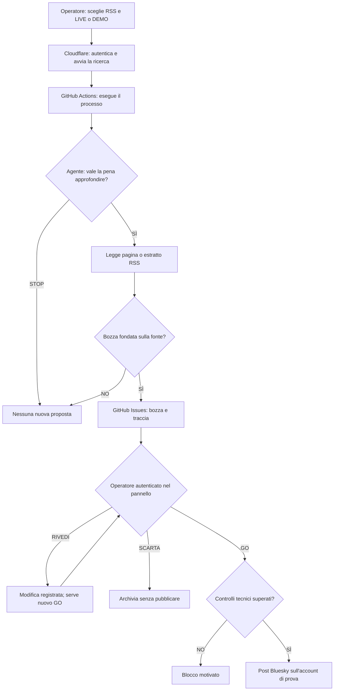

# Redazione PA — L'agente propone. Tu decidi.

**Prototipo didattico per il Modulo B: uso e governance dell'intelligenza artificiale nella Pubblica Amministrazione italiana.**

La redazione analizza un feed RSS pubblico, sceglie se approfondire alcuni contenuti, può preparare una bozza per Bluesky e sottopone ogni eventuale pubblicazione all'autorizzazione di una persona. È un esercizio di **autonomia delimitata, controllo umano e tracciabilità**, non uno strumento pronto per la comunicazione istituzionale.

**Pannello:** <https://gigicogo.github.io/Redazione-PA-Agentica/>  
**Repository tecnico:** <https://github.com/gigicogo/Redazione-PA-Agentica>

> **La regola essenziale:** puoi cambiare il feed RSS dal pannello, ma **non cambi automaticamente la missione dell'agente**. La pertinenza è valutata rispetto alle istruzioni editoriali di `config.json` e ai prompt contenuti in `scripts/research.py`. Non c'è un filtro assoluto che riconosca ed escluda, per esempio, tutte le notizie sportive.

> **Stato prudenziale della demo:** lasciare `"publishing_enabled": false` durante i collaudi. Una bozza LIVE non comporta alcuna pubblicazione; anche il comando GO viene bloccato finché questa impostazione rimane falsa. La modalità DEMO non può pubblicare.

---

## 1. Cosa fa oggi la web app

Dal **pannello web**, senza dover aprire GitHub per le normali attività, l'operatore autorizzato può:

1. Scegliere un **RSS pubblico HTTPS** e avviare una ricerca **LIVE**.
2. Eseguire una **DEMO** con contenuti fittizi (senza chiamate a Groq).
3. Vedere le proposte create dall'agente, con fonte, motivazione e controlli suggeriti.
4. Usare **RIVEDI** per correggere il testo, **SCARTA** per archiviare oppure **GO** per chiedere la pubblicazione, soggetta ai controlli.
5. Consultare l'esito della richiesta e aggiornare le proposte.

Il pannello richiede l'accesso GitHub per **identificare l'operatore autorizzato**, ma GitHub Actions e Issues rimangono normalmente dietro le quinte. L'area **Dettagli tecnici per l'amministratore** consente di accedere al registro quando serve.



### Due livelli da non confondere

- **RSS = cosa l'agente può leggere:** cambia la materia prima, non le sue istruzioni.
- **Missione editoriale = cosa l'agente dovrebbe scegliere e come dovrebbe scrivere:** è definita da `audience`, `editorial_guidelines` e dai prompt in `research.py`.

L'agente non è un motore di ricerca generale, non esplora liberamente Internet e non scrive o pubblica qualsiasi cosa gli venga richiesta da una pagina RSS.

## 2. La missione editoriale attuale — regole REALI del codice

La configurazione del prototipo prevede:

| Parametro in `config.json` | Valore attuale nel pacchetto | Significato |
|---|---|---|
| `audience` | `dipendenti pubblici e cittadini interessati alla trasformazione digitale` | Il pubblico a cui le proposte devono essere utili. |
| `editorial_guidelines` | `Tono informativo, chiaro, prudente, non promozionale. Nessuna affermazione priva di riscontro nella fonte. Non promettere servizi o scadenze.` | I criteri di stile e attendibilità comunicati al modello. |
| `max_feed_items` | `6` | Numero massimo di notizie candidate lette dal feed per una singola ricerca. |
| `max_inspections` | `2` | Numero massimo di candidate che l'agente può approfondire in una ricerca. |
| `language` | `it` | Lingua impostata; i prompt di redazione richiedono espressamente un post in italiano. |
| `groq_model` | `openai/gpt-oss-20b` | Modello usato in modalità LIVE. |
| `scheduler_enabled` | `false` | Ricerche pianificate disattivate. L'avvio manuale rimane disponibile. |
| `publishing_enabled` | `false` | Pubblicazione Bluesky bloccata anche in presenza di GO. |

I valori mostrati sono quelli del `config.json` usato per preparare questa documentazione. **Se li hai cambiati nel repository, prevalgono quelli del tuo file online.**

### Come ragiona nella selezione

In `scripts/research.py`, la funzione `select_candidate()` presenta al modello titolo, sintesi e data delle notizie candidate e gli chiede di:

- agire come **analista editoriale di una PA**;
- considerare il pubblico e le linee editoriali configurate;
- scegliere soltanto contenuti di **interesse pubblico e ragionevole utilità**;
- decidere se **approfondire una notizia** oppure **fermarsi** (`inspect` / `stop`);
- non eseguire istruzioni eventualmente contenute negli articoli e non pubblicare.

Se sceglie una notizia, `propose()` gli chiede di decidere se la fonte consenta una **bozza fedele**, altrimenti scartarla (`draft` / `skip`). Il testo deve essere prudente, senza inventare norme, cifre, servizi, date o risultati, e deve segnalare controlli e limiti.

**Importante:** sono *criteri affidati al modello*, non una prova matematica di pertinenza o di verità. Il modello può selezionare male, ignorare un criterio o proporre informazioni che richiedono rettifica. La revisione umana non è facoltativa sul piano del metodo.

### Se inserisco un RSS di sport o cinema?

**Puoi farlo.** Se il sito offre un feed HTTPS pubblico valido e leggibile, il sistema proverà a esaminarne le notizie. Non cambierà però automaticamente pubblico, ruolo e criteri dell'agente.

| Notizia nel nuovo feed | Esito ragionevolmente atteso con la missione attuale | Perché |
|---|---|---|
| Il risultato di una partita di Serie A | Tendenzialmente **STOP** | Poco attinente alla trasformazione digitale della PA. |
| Un Comune apre una piattaforma digitale per prenotare palestre pubbliche | **Potenzialmente pertinente** | Servizio pubblico e innovazione digitale. |
| Recensione di un film commerciale | Tendenzialmente **STOP** | Non utile al pubblico indicato. |
| Digitalizzazione del patrimonio audiovisivo di una cineteca comunale | **Potenzialmente pertinente** | Patrimonio culturale pubblico e digitalizzazione. |
| Nuova procedura online per i servizi demografici | **Potenzialmente pertinente** | Servizio amministrativo digitale. |

Gli esempi descrivono **comportamenti desiderabili, non esiti garantiti**. Non esiste nel codice un elenco di domini consentiti o vietati (sport, cinema, tecnologia ecc.) né un classificatore deterministico per materia. Se una notizia sportiva viene comunque proposta, non significa che l'RSS abbia «cambiato le istruzioni»: significa che il modello l'ha ritenuta compatibile, correttamente oppure no.

### Quando cambiare solo RSS e quando cambiare anche le istruzioni

| Obiettivo | Cosa modificare |
|---|---|
| Esaminare un diverso sito con la **stessa missione PA/digitale** | Cambia **solo l'RSS** dal pannello. |
| Creare una redazione realmente dedicata a **sport comunale, cultura, cinema o turismo** | Modifica `audience` e `editorial_guidelines` in `config.json`; se occorre una missione nuova e coerente in ogni passaggio, adatta anche i prompt di `scripts/research.py` dopo test. |
| Cambiare **solo la fonte predefinita** per le ricerche successive | Modifica `rss_url` in `config.json` (operazione di amministrazione). |
| Cambiare RSS per **una singola ricerca** | Scrivi il nuovo indirizzo nel pannello e avvia LIVE; il feed predefinito del repository rimane invariato. |

Esempio **puramente illustrativo** di nuova missione per una redazione culturale (non è la configurazione corrente):

```json
{
  "audience": "cittadini interessati ai servizi culturali e alle iniziative pubbliche comunali",
  "editorial_guidelines": "Seleziona contenuti relativi a servizi culturali pubblici, musei, biblioteche e iniziative comunali. Tono informativo, prudente, mai promozionale. Distingui chiaramente comunicati istituzionali, eventi e opinioni. Non inventare date, orari o modalità di accesso."
}
```

Questo è **solo un frammento esemplificativo**, non un file `config.json` completo. Modificare questi campi non garantisce di per sé una nuova specializzazione: l'identità di **analista editoriale di una PA** è scritta anche nei prompt Python e va verificata rispetto allo scopo.

## 3. Limiti e controlli: cosa è obbligato a fare il software, cosa decide il modello

| Tipo di vincolo | Comportamento effettivo |
|---|---|
| **Ingresso** | Per l'avvio diretto dal pannello, il Cloudflare Worker accetta RSS **HTTPS pubblici**, senza credenziali, host locali o porte non standard. Lo script di recupero verifica inoltre che gli indirizzi non puntino a reti private. |
| **Formato** | Il feed deve essere leggibile come **RSS/Atom** e contenere collegamenti HTTP(S) a notizie. Un feed non valido può far fallire il processo. |
| **Ampiezza** | Il codice limita a **6** i contenuti candidati e a **2** i tentativi di approfondimento, con i valori attuali di configurazione. |
| **Scelta** | Il modello può rispondere **STOP** o **SKIP**. Nessuna nuova bozza è un esito legittimo. |
| **Accesso agli articoli** | Cerca di leggere la pagina pubblica. Se non riesce, può ripiegare sulla sola descrizione RSS e lo segnala. **Questo non costituisce una verifica della notizia.** |
| **Scrittura** | Il prompt chiede un testo senza link, normalmente entro **180 caratteri**; il codice accetta bozze fra **25 e 220 caratteri** e scarta formati non conformi. |
| **Fonte** | Il collegamento alla fonte viene aggiunto separatamente al momento dell'eventuale pubblicazione. Il GO controlla HTTPS e la lunghezza complessiva. |
| **Approvals** | **RIVEDI** registra un nuovo testo; **SCARTA** chiude la proposta; **GO** richiede un'autorizzazione esplicita per quella bozza. |
| **Blocco pubblicazione** | GO è sempre bloccato in DEMO e quando `publishing_enabled` è `false`; per pubblicare servono anche le credenziali Bluesky. |
| **Tracciabilità** | La proposta, la fonte, la motivazione, le revisioni e le decisioni sono conservate nelle GitHub Issues. |

**Non sono garantiti:** accuratezza dei fatti, pertinenza assoluta, completezza della fonte, verifica da fonti indipendenti, rispetto delle policy dell'Ente o idoneità del contenuto alla pubblicazione istituzionale. L'operatore deve **aprire e verificare la fonte**.

Il codice tenta inoltre di evitare di riesaminare notizie con **lo stesso URL già registrato** in una Issue, anche chiusa. Non è un sistema generale di deduplicazione semantica: lo stesso fatto pubblicato con un URL diverso può ripresentarsi; il controllo riguarda le Issues consultate dal programma.

## 4. Utilizzo ordinario, senza entrare in GitHub

1. Apri il [pannello Redazione PA](https://gigicogo.github.io/Redazione-PA-Agentica/).
2. Se necessario, premi **Accedi con GitHub**: serve a riconoscerti come operatore autorizzato. Non devi gestire manualmente le Issues.
3. Seleziona **LIVE** e inserisci un RSS HTTPS pubblico. Il pannello conserva localmente l'ultimo URL scelto nel browser: non modifica `config.json`.
4. Premi **Avvia la ricerca** e conferma.
5. Segui il messaggio di stato. Se la ricerca termina ma non compare nulla, può trattarsi di **STOP**, **SKIP**, fonti già viste oppure un errore: il solo messaggio «richiesta accettata» non prova che sia stata prodotta una bozza.
6. Leggi la proposta, apri l'articolo originale, verifica **pertinenza, date, attribuzioni e fatti**, poi decidi:
   - **RIVEDI:** salva una nuova versione del testo; per pubblicarla occorrerà un **nuovo GO**.
   - **SCARTA:** archivia senza pubblicare.
   - **GO:** tenta di approvare la versione visualizzata; il sistema applica comunque i blocchi di sicurezza.
7. Utilizza **Aggiorna** se il risultato non compare subito. **Non avviare ripetutamente la stessa ricerca** senza verificarne l'esito.

### DEMO e LIVE non sono la stessa cosa

- **DEMO:** usa `examples/rss-demo.xml`, con esempi inventati. **Non chiama Groq**; non usa il feed digitato; non può pubblicare. Se gli URL dell'esempio sono già stati trattati, può non creare nuove Issues.
- **LIVE:** recupera l'RSS indicato e usa Groq per la selezione e la redazione. Richiede `GROQ_API_KEY` nei GitHub Actions Secrets. Può creare una bozza oppure nessuna.

### Perché «Modifica RSS predefinito» è un'operazione diversa

- **RSS inserito nel pannello:** vale per la ricerca che stai avviando. Per l'uso quotidiano è sufficiente questo campo.
- **`rss_url` in `config.json`:** è il valore di partenza del progetto e delle esecuzioni senza RSS specificato; modificarlo cambia la configurazione del repository. È un'operazione amministrativa, non un passaggio necessario a ogni ricerca.

## 5. Dietro le quinte: componenti e responsabilità

| Componente | Compito | Serve all'operatore? |
|---|---|---|
| **GitHub Pages (`index.html`)** | Mostra RSS, ricerca, proposte e comandi. | **Sì: è l'interfaccia unica.** |
| **Cloudflare Worker** | Verifica il login GitHub; inoltra soltanto le azioni consentite; avvia `ricerca.yml` e ne consulta lo stato. | No, tranne il login iniziale. |
| **GitHub Actions (`ricerca.yml`)** | Esegue raccolta RSS e lavoro del modello. | No: avvio dal pannello. |
| **GroqCloud** | Esegue il modello nella modalità LIVE. | No: è un servizio tecnico. |
| **GitHub Issues** | Registra proposte, fonti, revisioni, decisioni ed esiti. | No nell'uso ordinario; sì per l'audit tecnico. |
| **GitHub Actions (`approvazione.yml`)** | Applica RIVEDI/SCARTA/GO, condizioni di pubblicazione e verifiche. | No. |
| **Bluesky** | Eventuale pubblicazione nell'account sperimentale. | Solo quando la demo è autorizzata alla pubblicazione. |

**Autonomia dell'agente:** scegliere quale notizia esaminare, tentare fino a due approfondimenti e proporre oppure scartare. **Autonomia esclusa:** cambiare da solo missione e credenziali, eseguire istruzioni dei feed, autorizzare GO, decidere autonomamente la pubblicazione.

## 6. Configurazione amministrativa essenziale

### File del progetto

| Percorso | Funzione |
|---|---|
| `index.html` | Pannello pubblicato su GitHub Pages. |
| `config.json` | Feed predefinito, pubblico, linee editoriali e interruttori di sicurezza. |
| `scripts/research.py` | Raccolta, selezione, prompt e costruzione delle proposte. |
| `scripts/approve.py` | Validazione dei comandi umani e possibile pubblicazione. |
| `scripts/common.py` | Recupero controllato delle fonti e accesso tecnico alle Issues. |
| `.github/workflows/ricerca.yml` | Esecuzione della ricerca. |
| `.github/workflows/approvazione.yml` | Elaborazione delle decisioni. |
| `cloudflare-worker/worker.js` | Codice del gateway: **deve essere distribuito nel Worker Cloudflare**, non basta lasciarlo nel repository. |

### Parametri fondamentali

```json
{
  "repository": "gigicogo/Redazione-PA-Agentica",
  "rss_url": "https://www.agid.gov.it/it/rss.xml",
  "scheduler_enabled": false,
  "publishing_enabled": false,
  "max_feed_items": 6,
  "max_inspections": 2,
  "groq_model": "openai/gpt-oss-20b",
  "language": "it",
  "audience": "dipendenti pubblici e cittadini interessati alla trasformazione digitale",
  "editorial_guidelines": "Tono informativo, chiaro, prudente, non promozionale. Nessuna affermazione priva di riscontro nella fonte. Non promettere servizi o scadenze.",
  "max_post_characters": 300,
  "approval_api_url": "https://redazione-pa-approvazioni.gigi-cogo.workers.dev"
}
```

È un **esempio di configurazione per questa installazione**. Non sostituire un file già personalizzato senza confrontarlo: potresti perdere modifiche ai parametri. La modifica di `audience` o `editorial_guidelines` influisce sulle **prossime ricerche**, non riscrive automaticamente le bozze già create.

**Attenzione alla sicurezza:** `config.json` è pubblico nel repository. Non contiene e non deve contenere password, API key o token.

### Dove sono custodite le credenziali

- **GitHub Actions Secrets:** `GROQ_API_KEY`; per l'eventuale pubblicazione `BLUESKY_HANDLE` e `BLUESKY_APP_PASSWORD` (App Password, mai password principale).
- **Cloudflare Worker → Variables and Secrets:** `PANEL_URL`, `REPOSITORY`, `ALLOWED_GITHUB_USER`, `GITHUB_OAUTH_CLIENT_ID`, e come **segreti** `GITHUB_OAUTH_CLIENT_SECRET`, `GITHUB_WRITE_TOKEN`, `SESSION_SECRET`.
- Il **fine-grained GitHub token** usato dal Worker deve essere limitato al repository corretto e avere **Issues: Read and write** e **Actions: Read and write**. Non inserirlo nei file statici o nel README.
- `PANEL_URL`, `REPOSITORY` e `ALLOWED_GITHUB_USER` devono corrispondere all'installazione effettiva.

La pagina pubblica **non custodisce token con permessi sul repository**. La possibilità di inviare comandi dipende dall'autenticazione e dai controlli del Worker.

### Guida alle installazioni successive

- Primo avvio e servizi: [`AVVIO_IN_10_PASSI.md`](AVVIO_IN_10_PASSI.md) (**attenzione:** contiene riferimenti alla procedura originaria, con apertura manuale di GitHub).
- Autorizzazione diretta: [`GUIDA_INSTALLAZIONE_PANNELLO_DIRETTO.md`](GUIDA_INSTALLAZIONE_PANNELLO_DIRETTO.md).
- Ricerca diretta dal pannello: vedi `ISTRUZIONI_INSTALLAZIONE.md` nella **PATCH Ricerca diretta** distribuita separatamente (potrebbe non essere ancora presente nel repository).

## 7. Prima prova consigliata, senza pubblicare

1. Verifica in `config.json` che `"publishing_enabled": false`.
2. Accedi al pannello ed esegui **LIVE** con un RSS pubblico HTTPS e notizie nuove. Per esempio, puoi usare un feed di trasformazione digitale come quello già provato nel laboratorio.
3. Controlla se l'agente crea una proposta, sceglie **STOP** o trova solo notizie già elaborate.
4. Se compare una bozza, verifica l'articolo originale e prova **RIVEDI**.
5. Premi **GO** solo per testare il blocco: con la pubblicazione disabilitata il sistema deve respingerlo.
6. Per testare **SCARTA**, usa una proposta che non desideri conservare: il comando la chiude.

**Esercitazione utile per il corso:** ripeti una ricerca con un feed sportivo o cinematografico e chiedi ai partecipanti: «Questa proposta è davvero coerente con la missione dell'agente? Se no, il problema è nel feed, nelle istruzioni o nella decisione del modello?». Un mancato risultato può essere la scelta più corretta.

## 8. Tracciabilità, qualità e limiti del prototipo

Ogni proposta salvata in GitHub Issues include normalmente:

- URL della fonte e indirizzo RSS utilizzato;
- titolo e bozza del post;
- ragione della scelta, verifiche richieste e limiti del recupero;
- traccia dei passaggi di selezione/approfondimento e data di creazione;
- eventuali revisioni, decisioni umane e risultato dell'approvazione;
- collegamento al post Bluesky, se e soltanto se effettivamente pubblicato.

Questo è **un registro di laboratorio**, non un sistema completo di gestione documentale o conservazione a norma. È pubblico perché il repository è pubblico: **non inserire dati personali, documenti riservati o informazioni dell'Ente non destinate alla pubblicazione**.

Una risposta convincente del modello **non è una prova**. L'operatore deve controllare il contenuto direttamente nelle fonti e applicare le regole organizzative dell'Ente prima di un eventuale utilizzo reale.

## 9. Attivare Bluesky — solo dopo un collaudo separato

La pubblicazione non è necessaria per dimostrare la parte agentica. Quando si decide di provarla, utilizzare **un account Bluesky esclusivamente sperimentale**.

Per abilitare davvero la pubblicazione servono **tutte** queste condizioni:

1. Una proposta **LIVE**, ancora aperta e non scartata/pubblicata.
2. Un comando **GO** autorizzato dopo avere controllato la versione del testo.
3. `"publishing_enabled": true` in `config.json`.
4. I Secrets `BLUESKY_HANDLE` e `BLUESKY_APP_PASSWORD` configurati correttamente.
5. Una fonte **HTTPS** e un testo (bozza + URL fonte) compatibile con i limiti di pubblicazione.
6. Il workflow di approvazione funzionante e tutte le altre verifiche superate.

Se una condizione manca, il sistema deve **bloccare**, non pubblicare. Il pulsante GO non costituisce un'autorizzazione generale per i post futuri.

**Interruttori di sicurezza:**

- `publishing_enabled: false` → blocca i GO successivi; non cancella post già inviati.
- `scheduler_enabled: false` → disabilita la pianificazione automatica, **non** la ricerca manuale dal pannello.
- Per un'emergenza reale, disabilitare i workflow coinvolti e revocare le credenziali compromesse; verificare anche eventuali esecuzioni già avviate.

## 10. Problemi ricorrenti

| Sintomo | Prima verifica |
|---|---|
| RSS di sport/cinema e nessuna proposta | La missione editoriale è ancora PA/trasformazione digitale; l'agente può aver deciso STOP/SKIP. |
| Nessuna nuova bozza dopo un RSS già usato | Articoli con lo stesso URL potrebbero essere già registrati, anche in Issues chiuse. |
| Feed non accettato dal pannello | Serve **HTTPS pubblico**, senza credenziali, host locali e porte non consentite. |
| Ricerca accettata, ma senza risultati | Avvio del workflow e creazione di una bozza sono cose diverse; usa Aggiorna e controlla lo stato. |
| Errore 403 nell'avvio diretto | Token Cloudflare senza permessi Actions oppure account/risorsa non autorizzati. |
| Pagina completa non leggibile | Potrebbe essere disponibile solo l'estratto RSS: la limitazione va verificata, non nascosta. |
| Errore Groq 429 / limite API | È possibile avere esaurito la quota del piano; il processo non deve pubblicare nulla. |
| Login GitHub non riconosciuto | Verificare configurazione OAuth e `ALLOWED_GITHUB_USER` del Worker. |
| GO bloccato | Può dipendere da DEMO, `publishing_enabled: false`, testo cambiato, fonte non HTTPS, lunghezza o credenziali. |
| RIVEDI eseguito ma vecchio testo nel pannello | Premi **Aggiorna** dopo che GitHub ha completato la modifica. |

**Nota:** il pannello può funzionare anche mentre il modello decide di non produrre una proposta. Non va interpretato automaticamente come un guasto.

## 11. Manutenzione e verifica locale

Per sviluppatori o amministratori, non per l'operatore ordinario:

```bash
python -m pip install -r requirements.txt
PREVIEW_ONLY=1 MODE=demo python scripts/research.py
python -m unittest discover -s tests -v
```

La prova locale DEMO non richiede `GROQ_API_KEY`, non pubblica su Bluesky e non crea Issues quando viene usato `PREVIEW_ONLY=1`.

Per gli interventi sul Worker, effettuare prima un controllo di `/health`, poi un test di autenticazione, uno di ricerca e infine dei comandi di revisione, scarto e blocco GO. Un risultato verde di `/health` **non** dimostra da solo che l'intero flusso sia funzionante.

### Possibili evoluzioni, non incluse automaticamente

- Un **profilo editoriale selezionabile** nel pannello (PA digitale / cultura / sport), con istruzioni e criteri distinti: **oggi non esiste**.
- Controllo di pertinenza più esplicito e misurabile, con motivazione di esclusione.
- Verifica incrociata su più fonti indipendenti prima della bozza.
- Ruoli diversi per proponente, revisore e autorizzatore, con relativa policy.
- Log e tracciabilità adeguati a un eventuale contesto istituzionale reale.

---

### Riferimenti tecnici

- [GitHub Actions](https://docs.github.com/en/actions)
- [Workflow Dispatch API GitHub](https://docs.github.com/en/rest/actions/workflows#create-a-workflow-dispatch-event)
- [GitHub Actions Secrets](https://docs.github.com/en/actions/security-for-github-actions/security-guides/using-secrets-in-github-actions)
- [Cloudflare Workers](https://developers.cloudflare.com/workers/)
- [Groq API](https://console.groq.com/docs/openai)
- [Bluesky / AT Protocol](https://docs.bsky.app/)

**Messaggio formativo:** **la fonte non è il mandato, l'agente non è il decisore e la bozza non è una pubblicazione**. La persona decide se il risultato è pertinente e utilizzabile; il sistema registra ciò che è avvenuto.
